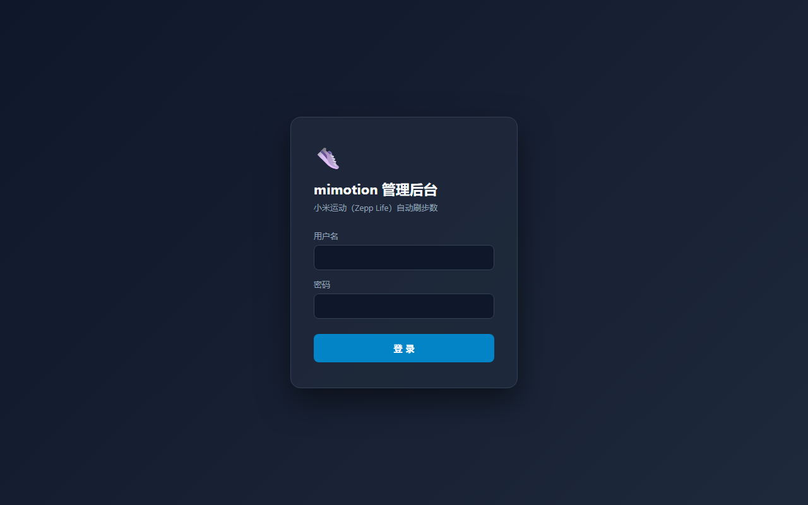
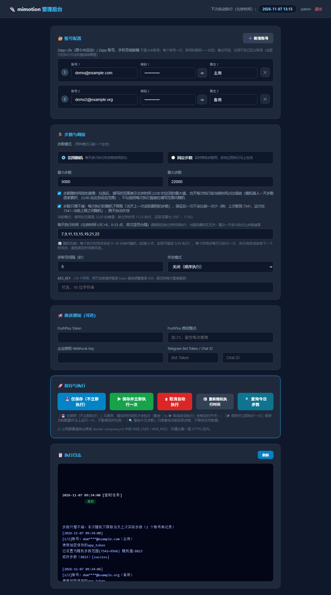

# mimotion-web

小米运动（Zepp Life）自动刷步数 —— 本地 Docker 自托管版，带 Web 管理界面。

不再依赖 GitHub Actions，在自己服务器/NAS 上用 Docker 一键部署，网页里配置账号即可长期自动运行。

> 核心刷步逻辑来自 [TonyJiangWJ/mimotion](https://github.com/TonyJiangWJ/mimotion)（Apache-2.0 License），本项目在其基础上封装了 Web 管理界面与 Docker 化部署，特此感谢。

---

## ✨ 功能特性

- **Web 管理界面**：账号密码登录（带 CSRF 防护 + 登录失败锁定），适合公网部署
- **账号动态管理**：「新增账号」逐行添加账号/密码（支持明文切换查看、单行删除），多账号自动用 `#` 分隔传给核心逻辑，无需手动拼接
- **步数模式（二选一）**：
  - 🏃 **范围随机**：在最小/最大步数间随机；可选「随时间线性递增」——填写的范围为北京时间 22:00 达到的峰值，更早执行按当前时间占比缩放（模拟真人一天步数逐渐累积）
  - 🎯 **固定步数**：每次执行都设为确切值，适合实时把步数改成某个目标值（此模式下每天执行时间只能填一个时间点）
- **定时调度**：按北京时间执行，与服务器时区无关；每个时间点在 0~59 分钟内随机执行，执行完自动重新随机，避免固定时间被风控
- **执行控制**：仅保存（等定时执行）/ 保存并立即执行一次 / 取消自动执行 / 重新随机执行时间，状态持久化，重启不丢
- **执行日志**：网页内查看最近 50 次执行记录（成功/失败、随机步数、接口返回）
- **步数查询**：一键查询各账号当日实际步数（只读操作，不改数据），结果直接显示在页面
- **推送通知（可选）**：PushPlus / 企业微信 Webhook / Telegram
- **Token 缓存**：配置 16 位 AES_KEY 后加密缓存登录 token，避免频繁登录触发 429

## 🖼️ 界面预览

| 登录页 | 管理后台 |
| --- | --- |
|  |  |
| 深色登录页，账号密码校验 | 配置账号、步数、调度、推送，查看执行日志 |

## 🚀 快速开始（Docker Compose）

镜像已通过 GitHub Actions 自动构建并发布到 GitHub Container Registry（公开可见），**拉取即用，无需在服务器上构建**：

```yaml
services:
  mimotion-web:
    image: ghcr.io/ranqingwen/mimotion-web:latest
    container_name: mimotion-web
    restart: unless-stopped
    ports:
      - "8000:8000"     # 左边是宿主机端口，可自行修改
    environment:
      - WEB_USER=admin        # ⚠️ Web 登录用户名，公网部署必改
      - WEB_PASS=admin123     # ⚠️ Web 登录密码，公网部署必改
      - TZ=Asia/Shanghai      # 时区
    volumes:
      - ./data:/app/data      # 数据持久化：配置、日志、加密 token 都在这里
```

```bash
docker compose pull && docker compose up -d   # 拉取镜像并启动，几秒完成
```

访问 `http://服务器IP:8000`，使用 `WEB_USER` / `WEB_PASS` 登录。所有配置在网页里填写并保存后存于 `data/config.json`，容器重建不丢失。

### 本地构建部署（克隆或上传项目文件）

无法访问 ghcr.io、或想修改代码自用时，可以用项目自带的 `docker-compose.yml` 本地构建：

```yaml
services:
  mimotion-web:
    build: .            # 使用项目目录下的 Dockerfile 构建镜像
    container_name: mimotion-web
    restart: unless-stopped
    ports:
      - "8000:8000"     # 左边是宿主机端口，可自行修改
    environment:
      - WEB_USER=admin        # ⚠️ Web 登录用户名，公网部署必改
      - WEB_PASS=admin123     # ⚠️ Web 登录密码，公网部署必改
      - TZ=Asia/Shanghai      # 时区
    volumes:
      - ./data:/app/data      # 数据持久化：配置、日志、加密 token 都在这里
```

```bash
git clone https://github.com/ranqingwen/mimotion-web.git
cd mimotion-web
docker compose up -d --build
```

也可以将仓库 zip 上传到服务器解压后在目录内执行同样的命令（在可视化工具中选择该路径创建编排同理，`build: .` 需要构建上下文）。

## 🧩 更多部署方式（NAS / 可视化工具 / 命令行通用）

只要环境里有 Docker（或 Docker Compose），把上面「快速开始」的 yaml 保存为 `docker-compose.yml`（改好 `WEB_USER` / `WEB_PASS`）：

- 命令行：`docker compose pull && docker compose up -d`
- NAS（群晖 Container Manager、威联通 Container Station 等）：导入该 yaml 创建项目/应用即可
- 其他可视化容器工具：用「自定义 compose/编排」功能粘贴部署

后续更新版本：`docker compose pull && docker compose up -d`（或在你的容器管理工具里点「重建/拉取最新镜像」）。

**本地构建**则把 `image:` 替换为 `build: .`（或仓库地址 `build: https://github.com/ranqingwen/mimotion-web.git#main`），执行 `docker compose up -d --build`。

**通用建议**：
- 防火墙及云服务器安全组放行 `8000` 端口后访问 `http://服务器IP:8000`
- 用 Nginx 反向代理等套一层 HTTPS
- 定期备份 `data` 数据目录（所有配置、日志、token 都在里面）

## ⚙️ 配置说明

### 环境变量（docker-compose.yml）

| 变量 | 说明 |
| --- | --- |
| `WEB_USER` | Web 登录用户名（默认 `admin`，**公网必改**） |
| `WEB_PASS` | Web 登录密码（默认 `admin123`，**公网必改**） |
| `TZ` | 时区，默认 `Asia/Shanghai` |

### 网页配置项

| 配置 | 说明 |
| --- | --- |
| 账号 / 密码 | 小米运动（Zepp Life）账号，**不是小米账号**；手机号或邮箱；支持多账号，逐行添加 |
| 最小/最大步数 | 范围随机模式下使用；勾选「随时间线性递增」时代表 22:00 的峰值 |
| 固定步数 | 固定步数模式下使用，每次执行设为该值 |
| 每天执行时间 | 北京时间 0-23 点，逗号分隔（如 `9,12,15,18,20,22`）；固定步数模式只能填一个 |
| AES_KEY | 可选，16 个字符；配置后加密缓存登录 token，避免频繁登录 429 |
| 推送配置 | PushPlus Token / 企业微信 Webhook Key / Telegram Bot Token + Chat ID，均可选 |

## 🔒 公网部署安全建议

- 务必修改 `WEB_USER` / `WEB_PASS`，不要使用默认值
- 建议通过 Nginx 反向代理等套一层 HTTPS 访问
- 登录接口带 CSRF 校验与失败锁定（5 次失败锁 2 分钟）
- 所有敏感数据仅保存在服务器本地 `data` 目录，不上传任何第三方

## ❓ 常见问题

- **提示登录失败 / 401**：确认账号是 Zepp Life（小米运动）账号，不是小米账号；密码错误可多试几次
- **429 限流**：同 IP 登录过多账号可能触发；配置 AES_KEY 缓存 token 可显著缓解
- **步数不对**：检查是否处于「范围随机 + 随时间递增」模式——非 22:00 执行时步数会按比例缩放，属正常现象；想固定就切「固定步数」模式

### 支付宝 / 微信没有同步步数

先明确一点：**日志里的「修改步数（xxxx）[success]」只代表 Zepp 服务器已接受该数值，不代表支付宝已经同步**。支付宝是从 Zepp 服务端拉取步数的，中间还隔着「绑定关系」和「同步延迟」两层。另外**小米运动（Zepp Life）App 内本身不会显示刷的步数，只有关联的第三方会同步**，所以不要用小米运动 App 里的数字判断是否成功。

按以下顺序排查：

1. **用「🔍 查询今日步数」确认刷步是否真的成功**
   页面点查询，若返回的步数与日志里的数值一致，说明 Zepp 服务端已改成功，问题在支付宝的绑定或同步；若查询结果不对，才是刷步本身失败。
2. **确认支付宝绑定的是哪个 Zepp 账号（最常见原因）**
   支付宝运动只能绑定**一个** Zepp 账号。多账号使用时，如果支付宝绑的是账号 A，账号 B 刷多少步都不会同步过来。去 支付宝 → 运动 → 设置 / 数据来源 查看当前绑定的账号。
3. **重新绑定（绑定存在但已失效）**
   Zepp Life App → 我的 → 设置 → 账号 → **注销账号 → 清空数据** → 重新登录 → 重新绑定支付宝（这一步与上游项目的建议一致）。绑定关系异常（改过密码、长期未登录等）都可通过重新绑定恢复。
4. **同步有延迟**
   支付宝不是实时读取，通常 10~30 分钟内更新。打开支付宝运动页面下拉刷新，或等待下一次同步时间点再看。
5. **仍不同步**
   换一个新注册的 Zepp 账号测试；若新账号正常，说明是原账号的绑定数据异常，需按第 3 步处理。

## ⚠️ 免责声明

本项目仅供学习交流使用，请勿用于任何商业或非法用途。使用本项目产生的一切后果由使用者自行承担，与作者无关。刷步数行为可能违反小米运动（Zepp Life）用户协议，请自行评估风险，账号被封禁等问题概不负责。

## 🙏 致谢

- 核心刷步逻辑：[TonyJiangWJ/mimotion](https://github.com/TonyJiangWJ/mimotion)（Apache-2.0），其又基于 [xunichanghuan/mimotion](https://github.com/xunichanghuan/mimotion) 与 [huangshihai/mimotion](https://github.com/huangshihai/mimotion)
- 登录接口 AES 加密密钥参考：[hanximeng/Zepp_API](https://github.com/hanximeng/Zepp_API)
- 步数查询接口（`band_data.json` 端点及 `summary` 步数解析方式）参考：[bentasker/zepp_to_influxdb](https://github.com/bentasker/zepp_to_influxdb)
- 本项目新增部分（Web 界面、调度、Docker 化、步数查询）：[ranqingwen](https://github.com/ranqingwen)

## 📄 License

[Apache-2.0](LICENSE)（沿用上游协议）
